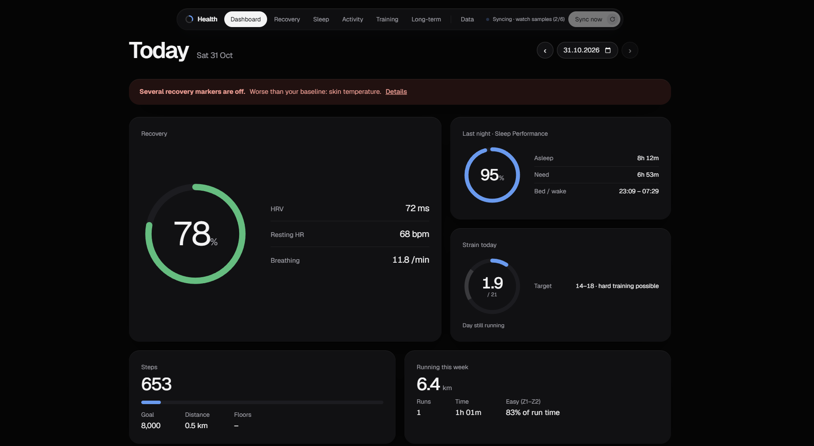

# Health dashboard

A local web dashboard for your Google Health data (Pixel Watch / Fitbit), with WHOOP-style scores computed from your own data.



Everything runs on your own machine (Windows or Linux): the data stays in a
SQLite file, the API listens on `127.0.0.1` only, and nothing is uploaded anywhere.

**Tabs**
- **Dashboard**: today's Recovery, last night's Sleep Performance, Strain so far
  with a target for the day, steps, this week's running.
- **Recovery**: daily Recovery with the HRV, resting HR and breathing z-scores
  behind it, and early warnings when several signals are off at once.
- **Sleep**: every night with stages (hypnogram), sleep need and Sleep Performance.
- **Activity**: steps, distance, floors, calories, active and sitting time; one
  day in detail (HR, steps per hour, workouts).
- **Training**: daily Strain, fitness / fatigue / form, every workout. A run
  shows pace, HR and cadence over time, HR zones, km splits and the GPS route.
- **Long-term**: Healthspan age, VO2 max, weight, monthly averages, ECGs, events.
- **Data**: every table in the database, paged, with CSV export.

How the scores are built: [docs/scores.md](docs/scores.md).

## How it works

```
Google Health API ──> health daily-sync ──> daily cache (daily values, sleep, workouts)
                  └─> health sync ──────> data/health.db (2 s heart rate, HRV, per-minute steps ...)
                                          │
          health scores, daily-check, ... ┘ writes scores into data/health.db
                                          │
          health serve (FastAPI, :8765) ──┘ reads both, serves the web app at /app/
```

Everything is one Python package, `health_dashboard` (in `src/`), installed
with [uv](https://docs.astral.sh/uv/) into one environment:

- `google/` does the Google login and keeps a cache of daily values, sleep
  sessions and workouts. It is derived from
  [google-health-mcp](https://github.com/partymola/google-health-mcp) by
  jjdelrio (GPL-3.0-or-later), trimmed to what the dashboard uses.
- `sync/` adds what that cache drops (intraday samples) and imports Google
  Takeout exports for data the API does not offer (Google's own sleep score,
  readiness, stress, running dynamics). `analysis/` and `scores/` compute the
  baselines, reports and scores.
- `app.py` is the API the dashboard talks to, and `mcp_server.py` an optional
  MCP server so Claude (or another MCP client) can read the same numbers and
  add notes.
- `web/` is the dashboard, in React + TypeScript (Vite). Its build is what
  the backend serves at `/app/` ([web/README.md](web/README.md)).

## Requirements

- Windows or Linux, with [uv](https://docs.astral.sh/uv/) (it fetches Python 3.13 if needed).
- [Node.js](https://nodejs.org/) LTS to build the web app (`winget install OpenJS.NodeJS.LTS`).
- A Google account with Google Health data and your own Google Cloud OAuth
  client ([docs/google-setup.md](docs/google-setup.md) walks you through it).

## Setup

1. **Install** (from the repo folder):

   ```
   uv sync
   ```

   This creates `.venv` with everything and the `health` command (`uv run health --help` lists what it can do). Then build
   the web app once (again after each `git pull` that changes `web/`):

   ```
   cd web
   npm ci
   npm run build
   ```

2. **Authorise Google** ([docs/google-setup.md](docs/google-setup.md) has the
   Google Cloud steps):

   ```
   uv run health auth
   uv run health doctor
   uv run health daily-sync --days 90
   ```

   The login is stored in `~/.config/google-health-mcp` (the folder
   google-health-mcp used, so an existing login keeps working).

3. **Tell it which watch is yours** (optional). Create `data/settings.json`:

   ```json
   {"watch": "Pixel Watch 3", "watch_start": "2025-06-01"}
   ```

   `watch` is the device name Google reports for your watch (default
   `Pixel Watch 3`). Only that device's data is used, so phone steps and
   other devices don't mix in. `watch_start` is your first day with the watch.
   If you leave it out, it is the first day of that watch's heart rate in the
   database, or a year ago before the first sync.

4. **Pull the intraday data and compute the scores**:

   ```
   uv run health sync
   uv run health scores
   ```

   The first run fits the Strain scale and the Recovery weights to your own
   history and stores them in `data/scores_config.json`. After that they stay
   frozen so scores don't drift; `--recalibrate` refits the Strain scale.
   Later runs only re-read the days whose raw data changed (`--full` rebuilds
   that cache from scratch, see docs/scores.md).

5. **Open the dashboard**:

   ```
   uv run health open
   ```

   This starts the API hidden in the background (if it isn't running yet) and
   opens http://127.0.0.1:8765/ in your browser. For the API in a console
   window instead: `uv run health serve`.

   On Windows, a shortcut to `.venv\Scripts\pythonw.exe -m health_dashboard open`
   gives you a one-click app with no console window; with `--no-browser` in
   `shell:startup` it starts the API at every logon. On Linux, a systemd user
   service running `.venv/bin/health serve` does the same.

### Where things live

Paths come from environment variables, with defaults for a checkout of this repo:

| Variable | Default | What |
|---|---|---|
| `HEALTH_DATA_DIR` | `data/` in the repo | `health.db`, settings, score calibration, logs, Takeout, sync lock |
| `GOOGLE_HEALTH_MCP_DB_PATH` | `~/.local/share/google-health-mcp/google_health.db` | the daily cache (where google-health-mcp kept it) |
| `GOOGLE_HEALTH_MCP_CONFIG_DIR` | `~/.config/google-health-mcp` | the Google login (`google_client.json`, `google_tokens.json`) |
| `HEALTH_FRONTEND_DIR` | `web/dist/` in the repo | the built web app |
| `HEALTH_ALLOWED_HOSTS` | | extra host names the API answers to (see below) |

### Phone access (optional)

The API stays bound to `127.0.0.1`. To open the dashboard on your phone, install
[Tailscale](https://tailscale.com) on the PC and the phone (same account), then
on the PC run:

```
tailscale up --unattended
tailscale serve --bg http://127.0.0.1:8765
```

`tailscale serve` proxies the local port over HTTPS to devices in your tailnet
only; `tailscale serve status` shows the address
(`https://<pc-name>.<tailnet>.ts.net/`). Don't use `tailscale funnel`, which
would make the dashboard public.

On the phone, open that address in Chrome and choose **Install app** (or
**Add to home screen**): the dashboard gets its own icon and opens without the
browser bar.

The API has no login, so it only answers to host names that can point at it
(`127.0.0.1`, `localhost`, IP addresses, `*.ts.net`, bare machine names) and
refuses writes that another website's page sends. If you reach it under
another name, add that name to the `HEALTH_ALLOWED_HOSTS` environment variable
(comma-separated) before starting the backend.

## Staying up to date

Opening the dashboard starts a sync (skipped if one finished in the last
15 minutes); the **Sync** button always runs one. A sync updates the daily cache,
pulls new intraday samples and recomputes every score. Only one sync runs at a
time, guarded by `data/.sync.lock`. A question to the MCP server starts one in
the background when the last one is over 3 hours old.

`health sync-on-access` starts a background sync from anything else, for
example a Claude Code `SessionStart` hook. It skips if one ran in the last 3 hours.
As a hook in `.claude/settings.json` (paths are yours):

```json
{"hooks": {"SessionStart": [{"matcher": "startup|resume", "hooks": [{"type": "command", "timeout": 15,
  "command": "\"C:/path/to/repo/.venv/Scripts/pythonw.exe\" -m health_dashboard sync-on-access"}]}]}}
```

Optional: `health takeout-import` loads a Google Takeout export
(`Takeout/Google Health`), and `health takeout-auto` can run from a
scheduled task to pick up new Takeout ZIPs from Downloads and import them.

## Notes and exclusions

Illness or a night of drinking wrecks HRV and resting HR for days. Mark them as
annotations (dashboard, API or MCP) and the baselines skip those nights. Which
kind excludes what is set in `src/health_dashboard/analysis/annotation_effects.py`.

## Project layout

```
src/health_dashboard/
  app.py, mcp_server.py   the API and the MCP server
  cli.py                  the `health` command
  config.py, settings.py  paths (environment) and per-user settings (data/settings.json)
  context.py              what the analyses and scores are passed (paths, watch, exclusions, databases)
  core/                   queries, sync jobs, annotations (shared by the API and the MCP server)
  google/                 Google login, API client, daily cache and its sync (from google-health-mcp)
  sync/                   intraday sync, sync-on-access, Takeout import
  analysis/, scores/      baselines, daily check, run and weekly reports; Strain, Recovery, Sleep, Healthspan
web/        the dashboard (React + TypeScript, Vite): src/ (views, charts.js, style.css, vendored
            Leaflet and fonts), public/ (manifest, app icons); the build in dist/ is not committed
docs/       scores.md (how the scores work), api.md (endpoints, MCP tools), google-setup.md
tests/      pytest suite on synthetic data, golden/scores.json (the expected scores), smoke/ (live checks),
            google_api/ (the Google code's tests, from google-health-mcp)
data/       your data, created on first sync, never committed
```

`data/` holds `health.db`, `settings.json`, the score calibration
(`scores_config.json`), logs, the Takeout copy and the sync state. The daily
cache and the Google tokens stay in the folders google-health-mcp used
(`~/.local/share/google-health-mcp`, `~/.config/google-health-mcp`). The
`.gitignore` keeps data, logs, tokens and OAuth client files out of git.

## Tests and linting

`uv run ruff check .` lints the Python code (settings in `ruff.toml`). To run it on
every commit: `uv tool install pre-commit`, then `pre-commit install` once.

`uv sync --extra dev`, then `uv run pytest` runs the test suite in `tests/`
on a made-up watch history that `tests/fixture_db.py` builds in a temporary folder, so it never touches `data/`. It includes a golden test:
every score on that history is stored in `tests/golden/scores.json`, and any
change to a number fails the test with a list of what moved. When a change to
the scores is intended, rewrite the file with `UPDATE_GOLDEN=1 uv run pytest`
and commit it with the change. GitHub Actions runs ruff and the suite on Linux
and Windows for every push and pull request.

Against your real data, with the API running:

```
uv run python tests/smoke/test_api.py    # every endpoint
uv run python tests/smoke/test_mcp.py    # the MCP server over stdio
```

`uv run python tests/check_api_models.py` checks every API response model
against a copy of your real data, without a running server.

## Limits

- Built for one person with one watch: workouts and samples are filtered to
  the device in `data/settings.json`. Tested with a Pixel Watch 3 only.
- Healthspan age compares VO2 max with norms for men aged 20-29. Adjust `REF`
  and `VO2_CAP` in `src/health_dashboard/scores/healthspan.py` for other ages or for women.
- The scores are modelled on WHOOP's published descriptions, not WHOOP's
  algorithms. Use them as a personal trend, not a medical measurement.

## License

GPL-3.0-or-later, see [LICENSE](LICENSE). `src/health_dashboard/google/` and
`tests/google_api/` are derived from
[google-health-mcp](https://github.com/partymola/google-health-mcp) 1.8.0 by
jjdelrio, GPL-3.0-or-later, and modified in October 2026; each copied file
says what changed.
